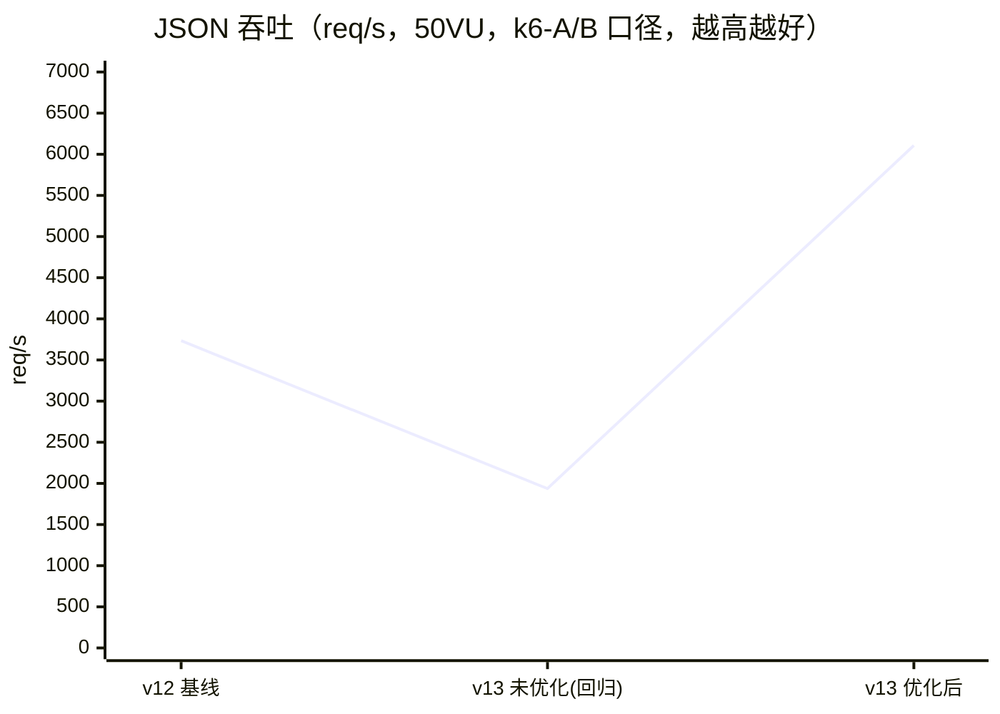
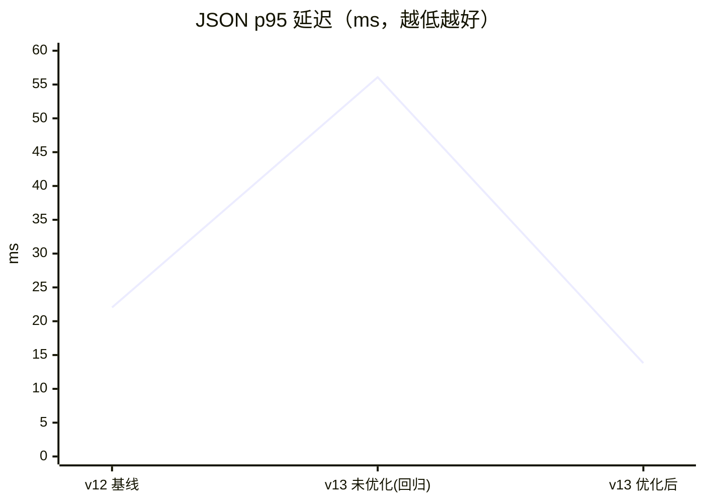
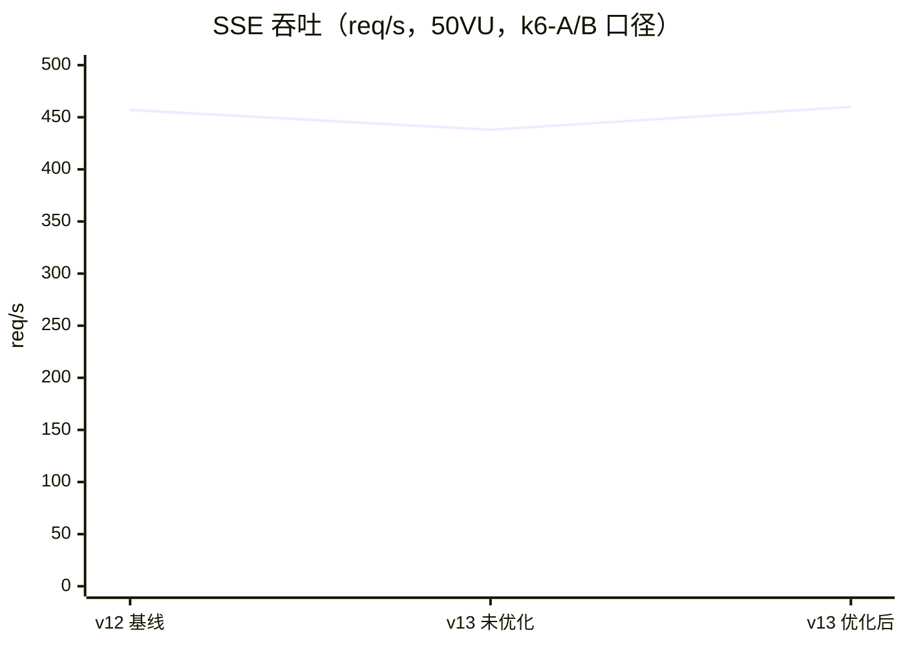
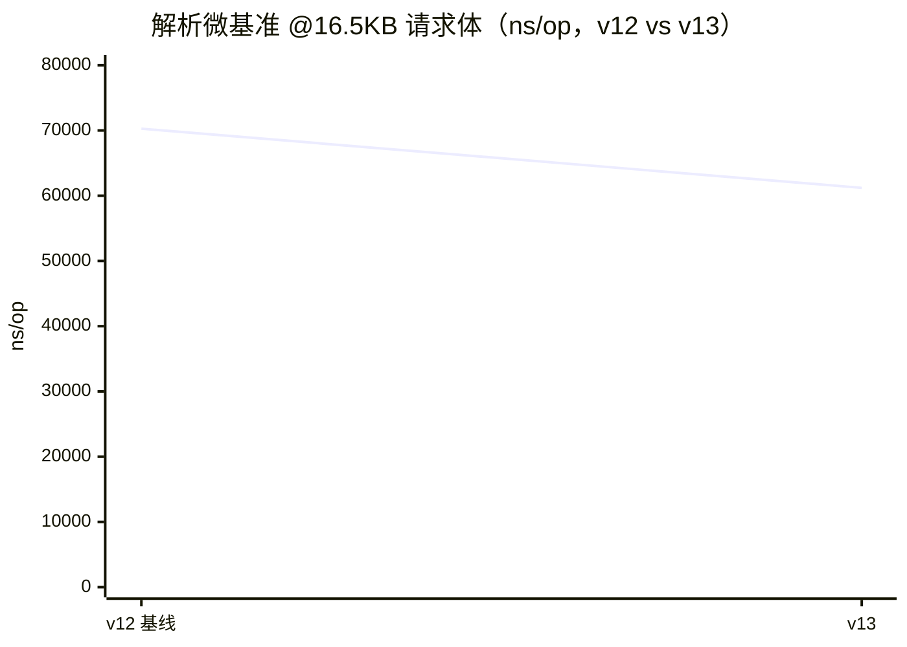
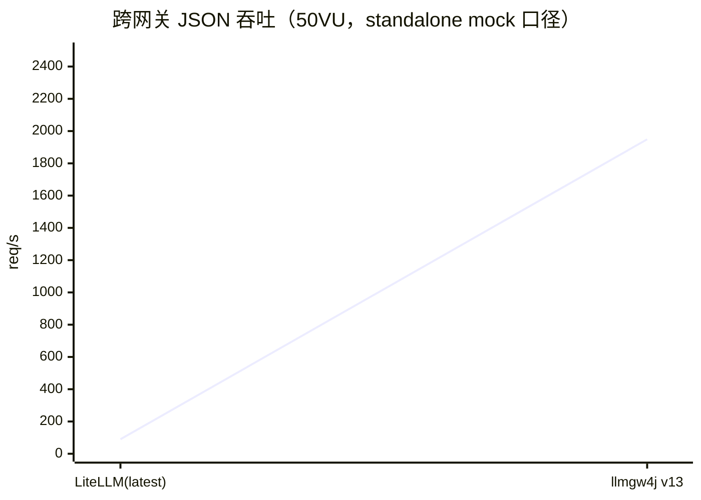

# llmgw4j 历史性能优化记录（v12 基线 → v13）

> 2026-11-10 更正：本文件是审查前历史记录，不代表当前产物。宿主机 llmgw4j 与 Docker LiteLLM 的跨网关对照条件不同，相关横向排名/倍数结论已撤回；下文保留原始数字以便追溯。当前统一容器测量见 [功能与性能报告](../gap-analysis.md)。

> 口径声明（务必先读）：本文所有数字来自三类**不同口径**的测量，图表内不混用：
> ① **k6-A/B 口径**：同 worktree 基线（v12 @f7e30a7）vs v13 工作区，同一内嵌 mock
>   上游、同一 `bench/k6-*.js`、50 VU / 30s——用于回归检测；
> ② **microbench 口径**：网络无关的单进程解析/缓冲微基准——用于热路径回归检测；
> ③ **跨网关对标口径**：独立 standalone mock 上游（20ms 首延迟）+ Docker 竞品，
>   同一脚本，但部署环境不同——不能用于横向排行，也不能与 ①② 相减。
> 单机 directional 数据遵循 `bench/README.md` 数据质量红线。

## 一、性能迭代时间线与折线

### 1. k6-A/B 口径：v12 基线 → v13 回归 → 优化后

### 2. microbench 口径：解析热路径（ns/op，越低越好）

### 3. 已撤回的异环境对照（仅历史原始数值）

交互式版本（可缩放）：**[performance-charts.html](performance-charts.html)**

## 二、v13 性能优化明细（本次迭代）

### 背景：A/B 发现真实回归

v13 能力补齐后，用 v12 worktree（@f7e30a7）同口径 A/B 发现 JSON 热路径回归：

| 指标（50VU JSON） | v12 基线 | v13 未优化 | Δ |
|---|---|---|---|
| 吞吐 | 3734/s | 1937/s | **-48%** |
| avg | 13.16ms | 25.53ms | +94% |
| p95 | 22.03ms | 56.08ms | +155% |
| 故障率 | 0% | 0% | — |
| SSE 吞吐 | 457/s | 438/s | -4%（被 mock chunk 节奏掩蔽） |

### 修复：4 项优化（全部保持默认行为不变）

| # | 优化 | 位置 | 问题 |
|---|---|---|---|
| 1 | mock 探针 join 门控 | `MockUpstreamServer.decorate` | `x-echo-received` 对**每个响应**执行全量 header 名 join——对齐 mock 上游，基准的公共路径被 v13 探针代码拖慢。改为 `x-llmgw-probe` 请求头显式开启 |
| 2 | HeaderPolicy 预编译 | `AllowListHeaderPolicy` | 每请求对每个 header 做 O(deny-list) 字符串 equals + 重复 toLowerCase；预编译为 exact HashSet + 前缀表，deny 用 O(1) Set，惰性建 map |
| 3 | ForwardingPolicy 单路由快路径 | `ForwardingPolicy.plan` | 默认配置（单路由/无重试）仍构建 ArrayList + fallback 解析；改为返回单元素不可变列表 |
| 4 | RetryConfig 构造期缓存 | 两个 Controller | 每请求新建 RetryConfig record；配置启动期冻结，缓存为 final 字段 |

### 优化后（同口径复测）

| 指标（50VU） | v12 基线 | v13 优化后 | Δ vs 基线 |
|---|---|---|---|
| JSON 吞吐 | 3734/s | **6107/s** | +64% |
| JSON avg / p95 | 13.16 / 22.03ms | **7.98 / 13.80ms** | -39% / -37% |
| SSE 吞吐 | 457/s | **460/s** | +0.7%（持平） |
| SSE avg | 108.92ms | 108.40ms | 持平 |
| 故障率 | 0% | 0% | — |

证据：`docs/verification/perf/k6-ab-v12-vs-v13.txt`；未优化回归数据
`docs/verification/w1-regression.log` 时代 + `perf/` 目录。

### 跨网关对标口径（独立 mock，注意与上表不可比）

| 指标（50VU，standalone mock） | llmgw4j v13 | LiteLLM latest |
|---|---|---|
| JSON 吞吐 | 1949/s | 90/s |
| JSON avg / p95 | 25.5 / 30.1ms | 554.9 / 574.1ms |
| SSE 吞吐 | 452/s | 43/s |
| 故障率 | 0% | 0% |

详见 [gap-analysis.md 第三节](../gap-analysis.md)；原始输出
`docs/verification/perf/cross-gateway/results-final.txt`。

## 三、microbench 口径：v12 → v13 逐尺寸对比

| payload | 指标 | v12 基线 | v13 | Δ |
|---|---|---|---|---|
| 158B | tree ns/op | 2847.1 | 2260.4 | -21% |
| 158B | stream ns/op | 1763.2 | 1661.8 | -6% |
| 1182B | tree ns/op | 5891.1 | 5274.1 | -10% |
| 1182B | stream ns/op | 5626.3 | 5020.2 | -11% |
| 4254B | tree ns/op | 19133.5 | 16521.9 | -14% |
| 4254B | stream ns/op | 18663.2 | 16166.6 | -13% |
| 16542B | tree ns/op | 70421.2 | 61132.4 | -13% |
| 16542B | stream ns/op | 70277.7 | 61204.5 | -13% |
| — | 缓冲 wrap/direct | 持平 | 持平 | 噪声内 |

证据：`docs/verification/baseline/microbench.log`（v12）vs
`docs/verification/perf/microbench-v13-clean.txt`（v13，单机独占跑）。
结论：解析热路径**全尺寸无回归**（本次 run 普遍更快，属机器状态噪声范围内的正向波动）。

## 四、v1 → v12 历史性能演进（摘要）

逐版本的完整基准记录（v1 boundedElastic 基线 → v2 全异步 → v3/v4 流式契约 →
v7 热路径三臂 A/B → v8 微基准 → v9 I/O 探路 → v12 多协议）已归档：
**[archive/README-history-v1-to-v12.md](README-history-v1-to-v12.md)**（原 README §五）。
要点：v2 消除 native 尾延迟退化（p99 122ms→36ms）；v7 executor 池扫描定容 32 线程
（SSE +30%）；v8 流式 payload 解析提速 2.3-3.5×；v9 两项候选被数据否决。

## 五、方法论

1. **先建基线再动代码**：v13 动工前先跑全量基线冒烟 + microbench + v12 worktree A/B。
2. **回归即修复**：A/B 发现 -48% 立即定位（对照 mock 公共路径 + 每请求分配），4 项修复全部保持默认行为等价。
3. **口径隔离**：三类口径不混用；跨口径数字绝不逐点相减。
4. **证据落库**：每次测量 tee 到 `docs/verification/`，本文引用的每个数字可溯源。
